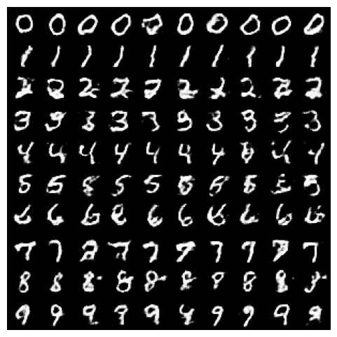
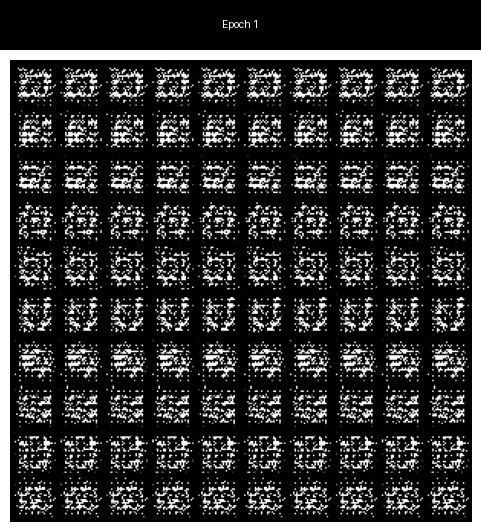
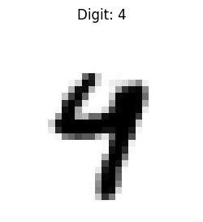
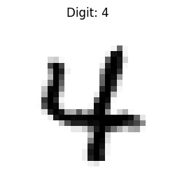
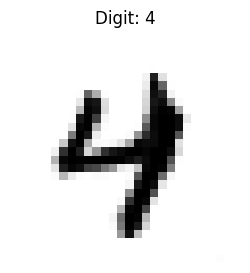
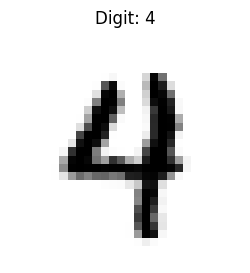
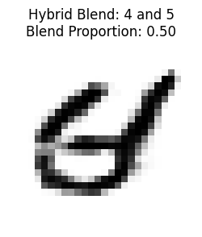
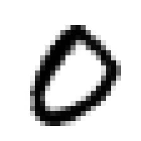
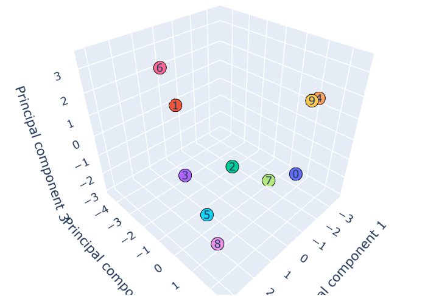

# MNIST Conditioned GAN

## Project summary, motivation and reflection 

This project trains a class-conditioned GAN on MNIST to generate handwritten digit images. It supports generating individual digits with different seed-controlled styles, interpolating between class embeddings to create hybrid digits, and visualising the learned embedding space with PCA.

My motivation has been to further my understanding of computer vision and generative models. I aim to use this project as a practise run in building a similar model for generating high quality images of animals and manipulating the latent and class embedding space to control generation.

MNIST provided this training ground to allow me to explore concepts such as adversarial training, class embeddings and latent spaces. It also gave me hands on experience building such networks in PyTorch and managing both mode collapse and zeroing gradients. 

## Features

- Train a conditioned GAN on MNIST to generate digits.
- Animate a GIF to demonstrate the epoch by epoch generation capabilities.
- Generate requested digits with the ability to fix handwriting styles.
- Generate "hybrid" digits to visualise the class embedding space.
- Animate a GIF generating transitions between classes. 
- Visualise class embedding space using 2D and interactive 3D PCA plots. 

## Example results

After each training epoch a 10x10 grid showing 10 random generations from each class is drawn. Below is an example:

<p align="center">
    
</p>

Once training has finished these outputs can be compiled into a GIF:

<p align="center">
    
</p>

The generator can now be used to generate requested digits in different handwriting styles and "hybrid" digits:

<table>
  <tr>
    <td align="center">Style 1<br></td>
    <td align="center">Style 2<br></td>
    <td align="center">Style 3<br></td>
    <td align="center">Style 4<br></td>
    <td align="center">Blend 4 & 5<br></td>
  </tr>
</table>

We can use this latent space interpolation to animate a GIF that smoothly transitions digits between classes:

<p align="center">
    
</p>

Finally, we can visualise the learned class embeddings using 2d and 3D PCA plots:

<p align="center">
    
</p>

[Open the interactive 3D PCA plot](https://js-mercer.github.io/MNIST-Conditioned-GAN/example-outputs/embeddings_pca_3d.html)

<a href="https://js-mercer.github.io/MNIST-Conditioned-GAN/example-outputs/embeddings_pca_3d.html">
    <p align="center">
        
    </p>
</a>

## Setup (Windows)

From the project directory, create and activate a virtual environment:

```powershell
py -m venv .venv
.\.venv\Scripts\Activate.ps1
```

Install the project dependencies:

```powershell
python -m pip install --upgrade pip
python -m pip install -r requirements.txt
```

In VS Code, select the project's `.venv` interpreter with **Python: Select Interpreter**.

Run training with:

```powershell
python train.py 
```

MNIST is downloaded automatically to `data/` the first time the training script runs.

### Training options

| Option | Default | Description |
|---|---:|---|
| `--epochs` | `50` | Number of training epochs |
| `--batch_size` | `64` | Number of images processed per batch |
| `--lr_d` | `0.0001` | Discriminator learning rate |
| `--lr_g` | `0.0004` | Generator learning rate |
| `--output_dir` | `outputs/` | Directory for generated epoch sample images |
| `--weights_dir` | `weights/` | Directory for saved model weights |

## Animate training progress

Training saves a sample grid named `epoch_NNN.png` for each epoch in
`outputs/`. After training, combine those images into a looping GIF with:

```powershell
python -m visualisations.training_progress
```

The GIF is saved to `outputs/training_progress.gif` by default. Use
`--input_dir`, `--output_path`, or `--duration` to customize the input folder, output path, or delay per epoch frame.

## Generate digits

After training has saved `weights/generator_cgan.pth`, generate a requested digit or digit morph with:

```powershell
python -m generate --base_digit 0 --digit2 5 --blend 0.0 --seed 4
```

The image is saved to `outputs/generate` by default. Use
`--weights_path` and `--output_dir` to choose different paths.

## Generate a class-cycle GIF

After training has saved `weights/generator_cgan.pth`, generate a 0-to-9 class cycle with:

```powershell
python -m visualisations.class_cycle --seed 4 --frames 20
```

The GIF is saved to `outputs/class_cycle/class_cycle.gif` by default. Use
`--weights_path` and `--output_dir` to choose different paths.

## Visualise class-label embeddings

After training, create both a static 2D PCA plot and an interactive 3D HTML
plot with:

```powershell
python -m visualisations.class_similarity
```

By default, the plots are saved under `outputs/class_similarity/`. Open
`embeddings_pca_3d.html` in a browser and drag to rotate the 3D view. Use
`--weights_path` and `--output_dir` to choose different paths.
